<div align="center">

  <!-- 🌌 MAKOTO SHINKAI TWILIGHT BANNER (CUSTOM ANIMATED SVG) -->
  

  <br/>

  <!-- ⌨️ ANIMATED TYPING SVG -->
  <a href="https://github.com/brian-silaban">
    
  </a>

  <br/>

  <!-- 🌸 AESTHETIC MOOD TAGS -->
  
  
  

</div>

<br/>

<div align="center">
  
</div>

<!-- ======================================================================= -->
<!-- 🪪 ANIME RPG STATUS WINDOW // CHARACTER CARD                            -->
<!-- ======================================================================= -->

<div align="center">
  <h3>✨ 『 STATUS WINDOW // キャラクター情報 』 ✨</h3>
  <p><i>"Di antara langit senja dan baris-baris kode yang tenang, setiap sistem dirangkai dengan presisi."</i></p>

  <!-- 🎮 CUSTOM ANIMATED RPG STATUS WINDOW & COZY LO-FI ROOM -->
  
</div>

<br/>

<!-- 🖥️ TERMINAL & RPG BIO TABLE -->
<table align="center" width="100%">
  <tr>
    <td width="52%" valign="top">
      <h4>📜 <code>brian@linux:~$ cat character_sheet.yaml</code></h4>

```yaml
player:
  name: "Brian Silaban"
  handle: "@brian-silaban"
  class: "Backend & Mobile Developer"
  alignment: "Chaotic Cozy / Clean Coder"

environment:
  os: "Linux Mint Cinnamon 🐧"
  time_of_day: "Tasogare-doki (Twilight / Senja)"
  soundtrack: "Chill Lo-Fi Beats & Rain Sounds 🎧"

current_quests:
  - "Merancang backend & skema database yang scalable"
  - "Membangun aplikasi mobile lintas platform dengan Flutter"
  - "Mengulik otomasi dan workflow di ekosistem Linux"
```

  </td>
    <td width="48%" valign="top">
      <h4>🎒 <code>Equipped Arsenal &amp; Magic</code></h4>
      <p><b>🐍 Backend &amp; Database</b></p>
      <p>
        
        
        
      </p>
      <p><b>📱 Mobile Development</b></p>
      <p>
        
        
      </p>
      <p><b>🐧 System, OS &amp; Dev Tools</b></p>
      <p>
        
        
        
      </p>
      <hr/>
      <p align="center">
        
      </p>
    </td>
  </tr>
</table>

<div align="center">
  
</div>

<!-- ======================================================================= -->
<!-- 🌠 TWILIGHT QUOTE & COZY FOOTER                                         -->
<!-- ======================================================================= -->

<div align="center">
  <br/>
  <blockquote>
    <p><i>"Momen ketika hari berganti malam dan dunia tampak kabur, itulah <b>Katawaredoki</b>.<br/>Tempat di mana imajinasi, secangkir kopi, dan baris kode bertemu."</i></p>
    <sub>— Terinspirasi dari <b>Kimi no Na wa (Makoto Shinkai)</b> • Ruang Koding Senja <b>@brian-silaban</b></sub>
  </blockquote>
  <br/>

  
</div>

